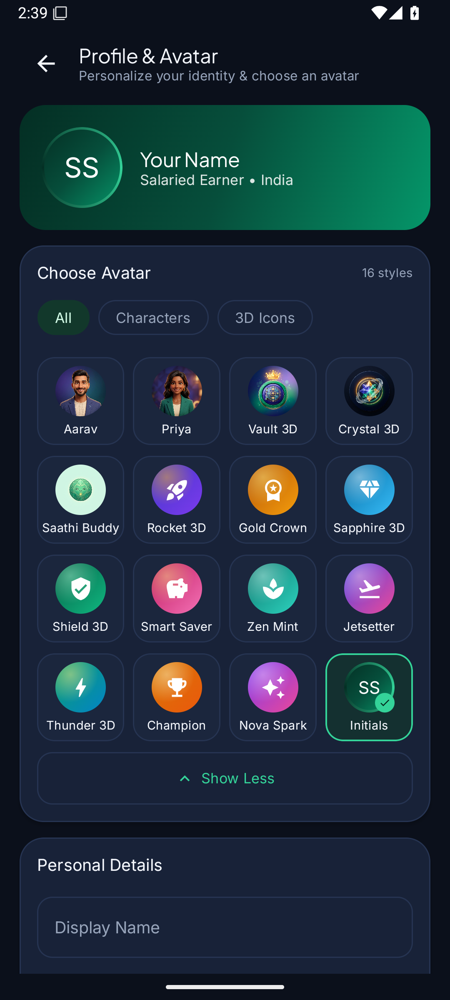
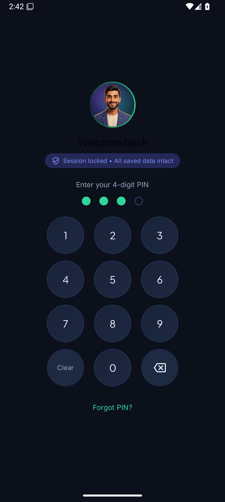
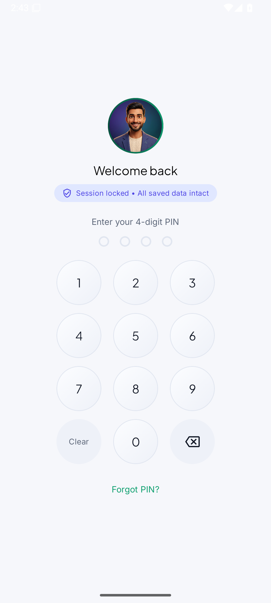

<div align="center">

# 💰 Salary Saathi (सैलरी साथी)

**A warm, intelligent personal finance companion for salaried professionals.**


<br/>

**Salary Saathi** helps salaried workers track monthly income, incentives, daily spending, budgets, and savings goals with **AI Saathi** (powered by Google Gemini).

</div>

---

## 📱 App Screenshots

| Dashboard & Income | AI Saathi Chat | Theme & Notifications |
| :---: | :---: | :---: |
|  |  |  |
| **Salary & Expense Summary** | **AI Natural Language Logging** | **Custom Theme System Cards** |

---

## ✨ Key Features

* 💵 **Monthly Salary Tracking:** Custom salary cycles (e.g., 1st or 30th of every month), base pay, bonuses, and side earnings.
* 🤖 **AI Saathi Assistant:** Type or talk to log expenses (*"Spent ₹250 on lunch"*), get smart budget advice, and tap interactive **Undo** badges.
* 📱 **UPI & Bank SMS Alerts:** Auto-parses UPI transaction notifications into instant expense records.
* 📊 **Category Budgets:** Set caps for Groceries, Utilities, Rent, Shopping, and Entertainment with color-coded warning bars.
* 🎯 **Savings Goals:** Track emergency funds, festival savings, and milestones.
* 🔒 **App Security:** 4-digit PIN lock screen with interactive dot indicator animations.
* 🎨 **Dynamic Color Themes:** Emerald, Sapphire, Obsidian Dark Mode, Indigo Velvet, and Deep Crimson.

---

## 📥 APK Download & Installation Guide (For Users)

### 📲 Step-by-Step Installation on Android Phone

1. **Download the APK:**
   * Go to the **[Releases](https://github.com/web-mdazads/aistudio-repository-template/releases)** section on the right side of this GitHub repository page.
   * Tap on **`SalarySaathi.apk`** under Assets to download it.

2. **Allow Installation from Unknown Sources:**
   * When you tap to open the downloaded APK, Android may show:
     > *"For your security, your phone is not allowed to install unknown apps from this source."*
   * Tap **Settings**.
   * Toggle ON **"Allow from this source"** (या *"Is srot se install ki anumati dein"*).

3. **Install & Launch:**
   * Tap **Install**.
   * Once finished, tap **Open** to launch **Salary Saathi**!

---

## 🚀 How to Upload APK File on GitHub (Creating a Release)

Aap apne users ke liye GitHub par APK download link banane ke liye ye steps follow karein:

### Step 1: Export / Generate the APK File
* **AI Studio se:** Top bar me **Settings** / **Export** icon ➔ **Export APK** / **Download APK** par click karke APK file download karein.
* **Android Studio se:** `Build` menu ➔ `Build Bundle(s) / APK(s)` ➔ `Build APK(s)`. File `app/build/outputs/apk/debug/app-debug.apk` me milegi.

### Step 2: GitHub Releases Open Karein
1. Apne GitHub Repository page par jayein: `https://github.com/web-mdazads/aistudio-repository-template`
2. Right side sidebar me **Releases** par click karein (ya **Create a new release** par click karein).

### Step 3: Nayi Release Create Karein
1. **Draft a new release** button par click karein.
2. **Choose a tag** dropdown me type karein `v1.0.0` aur click karein **Create new tag: v1.0.0**.
3. **Target:** `main` branch select rakhein.
4. **Release title:** `Salary Saathi v1.0.0 - Official Release`
5. **Description:** Release notes likhein (e.g. *"Salary Saathi Android App v1.0.0 with AI Saathi Assistant & Dynamic Themes"*).

### Step 4: APK File Upload Karein
1. Page ke bottom me **Attach binaries by dropping them here or selecting them** box dikhega.
2. Apne computer/mobile se `.apk` file (e.g., `SalarySaathi.apk`) ko yahan **Drag & Drop** karein ya select karke attach karein.

### Step 5: Publish Release
1. **Publish release** button par click kar dein.
2. Ab aapki release live ho gayi hai! Koi bhi user repository ke **Releases** tab par jaakar ek click me APK download kar sakta hai.

---

## 🖼️ How to Upload Logo & Screenshots on GitHub

### Method 1: Web Browser se Direct Upload
1. GitHub Repository home page par **Add file** ➔ **Upload files** button par click karein.
2. Apni logo image (`logo.png`) ya screenshots images ko upload box me drag & drop karein.
3. Commit Message me `Add app logo and screenshots to assets/` likhein.
4. **Commit changes** button par click karein.

### Method 2: Git Terminal se Upload
```bash
# Assets folder banayein aur images copy karein
mkdir -p assets
cp /path/to/logo.png assets/logo.png
cp /path/to/screenshot1.png assets/screenshot_1.png

# Git me add, commit aur push karein
git add assets/
git commit -m "Add app logo and screenshot assets"
git push origin main
```

### README me Logo ya Screenshot add karne ka Syntax:
```markdown


```

---

## 🛠 Tech Stack & Architecture

* **Language:** 100% Kotlin
* **UI Framework:** Jetpack Compose with Material Design 3 (M3)
* **Architecture:** MVVM (Model-View-ViewModel) + Clean Architecture
* **Concurrency:** Kotlin Coroutines & `StateFlow`
* **Local Database:** Room Database with KSP
* **Preferences:** Jetpack DataStore
* **AI Engine:** Firebase AI Logic / Google Gemini API SDK

---

## 📄 License
This project is licensed under the MIT License - feel free to use and customize it!
